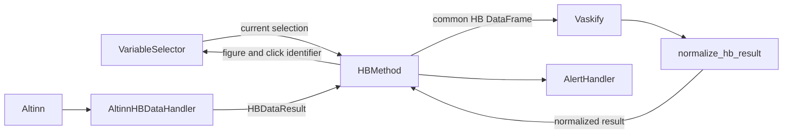

# HB methodology module architecture

## Scope

`HBMethod` integrates the framework UI with an HB data handler and Vaskify.
`AltinnHBDataHandler` is required in production. Vaskify owns the HB
calculation; the module must not reimplement it.

Detailed design, Altinn decisions, and test coverage are in
[architecture_design_detailed.md](architecture_design_detailed.md).

## Runtime architecture

## Runtime contract

| Step | Owner | Contract |
|---|---|---|
| Read selection | `HBMethod` | Read selected variable and canonical period at run time; do not retain user selections on the module instance. |
| Resolve periods | `resolve_hb_comparison_periods` | Use configured `TimeUnit` to resolve `(t-1, t)`. This is the current product assumption. |
| Prepare data | `AltinnHBDataHandler` | Return the common HB DataFrame and structured warnings; do not call Vaskify or present alerts. |
| Calculate | `HBMethod` / `run_hb_vaskify` | Validate the integration contract, then call Vaskify with explicit arguments. |
| Normalize and display | `normalize_hb_result` / `HBMethod` | Preserve Vaskify diagnostics and all input units; display results without recomputing HB logic. |
| Select unit | `HBMethod` | Send the stable `unit_id` from the clicked point to `VariableSelector`; do not rerun HB. |

## Configuration

| Component | Key | Required | Meaning |
|---|---|---|---|
| `HBMethod` | `hb_data_handler` | Yes | Injected `HBDataHandlerMeta`; production uses `AltinnHBDataHandler`. |
| `HBMethod` | `hb_variable_selector` | Yes | Configured variable selector title for the HB measure. |
| `HBMethod` | `configured_hb_time_unit` | Yes | The configured `TimeUnit` for the period selector. |
| `HBMethod` | `configured_hb_strata_variable` | No | Source variable used for strata; omit or pass `None` when unused. |
| `HBMethod` | `as_type` | No | Framework placement, `Tab` or `Window`, normally supplied by the module loader. |
| `AltinnHBDataHandler` | `configured_hb_form` | Yes | Altinn form identifier. |
| `AltinnHBDataHandler` | `hb_variable_to_feltsti` | Yes | Mapping from HB variable names to exact Altinn field paths; include the strata variable when configured. |

The YAML registry recognizes `HBMethod` and validates these constructor key
names. YAML values are passed through as-is; the loader does not construct an
`HBDataHandlerMeta` or `TimeUnit` from a mapping. Those objects must currently
be injected by Python code.

## Data contracts

| Contract | Required details |
|---|---|
| Input columns | `unit_id` (stable string), `period` (canonical string), `value` (numeric); optional `strata` and selector context. |
| Canonical periods | `YYYY`, `YYYY-1`/`YYYY-2`, `YYYY-Qn`, `YYYY-MM`, `YYYY-Www`, `YYYY-MM-DD`, matching the configured `TimeUnit`. |
| Input uniqueness | At most one row per `unit_id` and `period`; reject or explicitly resolve ambiguity, never silently aggregate. |
| Normalized result | One row per handler unit; retain `value_<period>`, Vaskify's ratio, median, limits, flags, and diagnostics. |
| Candidate state | Keep flagged (`1`), unflagged (`0`), and not-comparable (missing flag/diagnostics) distinct. |

## Ownership

| Component | Owns | Does not own |
|---|---|---|
| `HBMethod` (`modules/hb/hb_method.py`) | Callbacks, run state, structural validation, result figure, selector updates | Altinn queries, source reshaping, eligibility rules, HB mathematics |
| `HBDataHandlerMeta` | Handler contract and common input validation | Vaskify invocation |
| `AltinnHBDataHandler` | Altinn retrieval and conversion to common HB input | Alerts, plotting, Vaskify mapping |
| `run_hb_vaskify` | Vaskify construction, explicit argument mapping | Source access, Dash callbacks |
| `normalize_hb_result` | Result schema and reconciliation to handler units | UI, eligibility or diagnostic calculations |
| `Vaskify` | HB calculation | Framework UI and source access |

## Display and failure behavior

| Case | Behavior |
|---|---|
| Result | Plot `ratio` against `value_<selected period>`; show returned median and limits by `strata` without recalculation. |
| Handler warnings | One aggregate `AlertHandler` warning with the count; no row-specific details. |
| Run failure | Alert through `AlertHandler`, clear the current result, and log only module ID, selected variable, period, and exception type. |
| Sensitive data | Do not log exception details, tracebacks, or row-level data. |

## Altinn constraint

Resolve active submissions per identifier and requested period. Do not apply
identifier-only deduplication across both comparison periods. See
[altinnapiclient-documentation.md](altinnapiclient-documentation.md).
