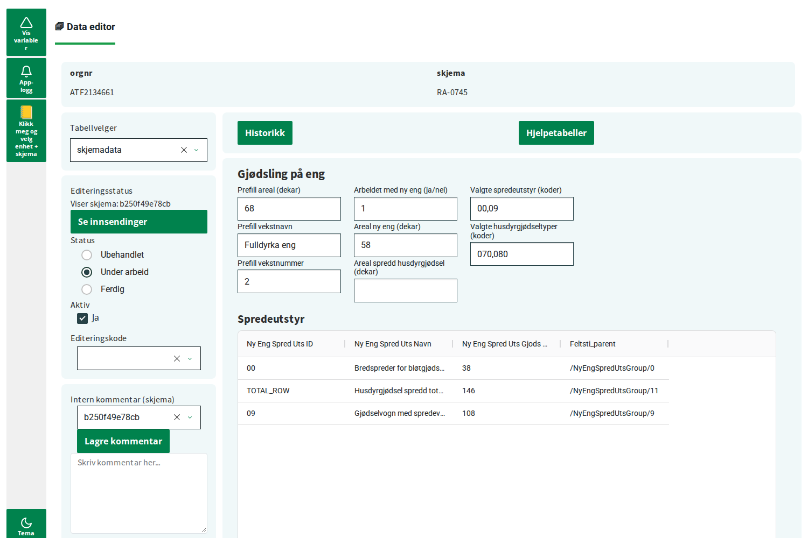

# Edit form data with the DataEditor

The **DataEditor** lets you look at and edit one submitted **form** at a time, for example
one Altinn questionnaire from one company. You decide how each form is shown. You do this
by building a **data view**: a layout with headers, input fields, calculations and lists.

Do these guides first:

- [Getting started: build your first app](getting_started.md)
- [Connect to your data](connecting_to_data.md)

You will learn:

- what the parts of the DataEditor are
- which variable selector settings the DataEditor needs
- how to set up a DataEditor, in YAML and in Python
- how to build data views for your forms
- how to use the DataEditor with your own data

## Before you start

The DataEditor reads data through a **Data handler**. A default implementation is provided for Altinn 3. This format is described in
[Data models](../datamodels.md). If your data comes from Altinn 3, the easiest way to get
it in this format is the package
[ssb-altinn-form-tools](https://github.com/statisticsnorway/ssb-altinn-form-tools). See
[Use your own data](#use-your-own-data) at the end of this guide.

To follow this guide without your own data, use the test data from the repository:

1. Clone the repository and install it:

   ```console
   git clone https://github.com/statisticsnorway/ssb-dash-framework.git
   cd ssb-dash-framework
   uv sync
   ```

2. Run the example app, to see what a finished DataEditor looks like:

   ```console
   uv run demo/altinn_app/app.py
   ```

3. Make a test database for your own app. Run this once, in a notebook or a Python file
   in the repository folder:

   ```python
   from ssb_dash_framework_testdata.altinn import build_db

   build_db.seed_sqlite("altinn_demo.sqlite")
   ```

   If you need to make the file again, delete it first.

## The parts of the DataEditor



The DataEditor is a tab with four parts:

1. **The info row** at the top. It shows key values for the form, for example the
   organisation number and the form name.
2. **The sidebar** on the left. It has the table selector (*Tabellvelger*), the editing
   status of the form (*Editeringsstatus*) and an internal comment (*Intern kommentar*).
3. **The buttons** at the top right. They open windows with more information, for
   example the editing history (*Historikk*) and support tables (*Hjelpetabeller*).
4. **The data view** in the middle. This is where you see and edit the values in the form.

You choose which parts to include.

## Step 1: The variable selector settings

The DataEditor shows the form that is selected in the variable selector. It needs these
settings:

| Setting | What it is | Example value |
| --- | --- | --- |
| `refnr` | The reference number of one submitted form. | `0e91287fe6da` |
| `ident` | The unit that submitted the form. | `12222222` |
| `time_units` | The period of the form. | `2026-01` |
| `grouping_variables` | Must include `altinnskjema`, the name of the form. | `RA-0187` |

The field for the form name must be called exactly `altinnskjema`.

In YAML, the `variableselector` block looks like this:

```yaml
app_settings:
  port: 8070
  stylesheet: lumen
  variableselector:
    refnr: refnr
    ident: ident
    time_units:
      name: periode
      frequency: month
    grouping_variables:
      - altinnskjema
```

In Python:

```python
VariableSelectorConfig(
    refnr="refnr",
    ident="ident",
    time_units={"name": "periode", "frequency": "month"},
    grouping_variables=["altinnskjema"],
)
```

> **Important:** In Python, `VariableSelectorConfig(...)` must come before you create the
> DataEditor and its parts.

## Step 2: Connect to the database

The DataEditor reads and saves data through the shared **connection**. Set it at the top of
`app.py`, as described in [Connect to your data](connecting_to_data.md).

For the test data:

```python
set_sqlite_connection("altinn_demo.sqlite")
```

For your own data on Dapla:

```python
set_parquedit_connection()
```

## Step 3: A minimal DataEditor

Make a folder for your app. If you use the test data, put `altinn_demo.sqlite` in the same
folder.

`app.yaml`:

```yaml
app_settings:
  port: 8070
  stylesheet: lumen
  variableselector:
    refnr: refnr
    ident: ident
    time_units:
      name: periode
      frequency: month
    grouping_variables:
      - altinnskjema
modules:
  tabs:
    - type: DataEditor
      settings:
        starting_table: skjemadata
        form_data_table: skjemadata
        form_list:
          - RA-0187
        period_col: iso_periode
        ident_col: ident
        refnr_col: refnr
        form_name_col: skjema
        field_name_col: feltsti
        field_value_col: verdi
      data_handler: StandardDataHandler
      sidebar:
        - type: DataEditorTableSelector
          form_data_tables:
            - skjemadata
          starting_table: skjemadata
      dataview:
        - type: DataViewCustom
          applies_to_forms:
            - RA-0187
          layout:
            - type: microlayout
              inputs:
                - refnr
                - periode
              layout:
                - type: header
                  label: Omsetning i varehandelen
                - type: input
                  label: Omsetning i perioden (kr)
                  variable: "/omsVirksomhetPerioden"
                - type: input
                  label: Antall ansatte
                  variable: "/antallAnsatte"
```

`app.py`:

```python
import os
from pathlib import Path

from ssb_dash_framework import AppConfig
from ssb_dash_framework import build_app_from_config
from ssb_dash_framework import config_parser_yaml
from ssb_dash_framework import main_layout
from ssb_dash_framework import set_sqlite_connection

# 1. Connect to the data. Use set_parquedit_connection() for your own data on Dapla.
set_sqlite_connection(str(Path(__file__).parent / "altinn_demo.sqlite"))

# 2. Read the app config. It sets up the app, the variable selector and the DataEditor.
config_path = Path(__file__).parent / "app.yaml"
config = AppConfig(**config_parser_yaml(str(config_path)))
app, tab_list, window_list = build_app_from_config(config)

# 3. Build the layout. The default values open one form from the test data.
app.layout = main_layout(
    window_list=window_list,
    tab_list=tab_list,
    default_values={
        "periode": "2026-01",
        "ident": "12222222",
        "altinnskjema": "RA-0187",
        "refnr": "0e91287fe6da",
    },
)

# 4. Start the app.
if __name__ == "__main__":
    app.run(
        debug=False,
        port=config.app_settings.port,
        jupyter_server_url=os.getenv("JUPYTERHUB_HTTP_REFERER", None),
        jupyter_mode="tab",
        threaded=False,
    )
```

Run the app. You should see a *Data editor* tab with the table selector on the left, and
the values *Omsetning i perioden* and *Antall ansatte* from the form.

These are the parts of the DataEditor block:

- `settings` tells the DataEditor where the forms are and what the columns are called:

  | Setting | What it is |
  | --- | --- |
  | `form_data_table` | The table with the values in the forms. |
  | `starting_table` | The table to show when the app starts. Usually the same as `form_data_table`. |
  | `form_list` | The names of the forms the DataEditor can show. |
  | `period_col` | The column with the period. |
  | `ident_col` | The column with the unit. |
  | `refnr_col` | The column with the reference number of the form. |
  | `form_name_col` | The column with the form name. |
  | `field_name_col` | The column with the name of each field, for example `/omsVirksomhetPerioden`. |
  | `field_value_col` | The column with the value of each field. |

- `data_handler` is the **data handler**. It reads and saves the data.
  `StandardDataHandler` works with the standard format.
- `sidebar` has the table selector. Add `DataEditorTableSelector` to every DataEditor. It
  tells the DataEditor which table to show, and the DataEditor uses it to pick the right
  data view.
- `dataview` has one data view for the form RA-0187. Step 5 explains how to build it.

### The same DataEditor in Python

```python
data_editor = DataEditor(
    settings=EditorSettings(
        starting_table="skjemadata",
        form_data_table="skjemadata",
        form_list=["RA-0187"],
        period_col="iso_periode",
        ident_col="ident",
        refnr_col="refnr",
        form_name_col="skjema",
        field_name_col="feltsti",
        field_value_col="verdi",
    ),
    data_handler=StandardDataHandler(),
    sidebar=[
        DataEditorTableSelector(
            form_data_tables=["skjemadata"],
            starting_table="skjemadata",
        ),
    ],
    dataview=[
        DataViewCustom(
            applies_to_forms=["RA-0187"],
            layout=[
                {
                    "type": "microlayout",
                    "inputs": ["refnr", "periode"],
                    "layout": [
                        {"type": "header", "label": "Omsetning i varehandelen"},
                        {
                            "type": "input",
                            "label": "Omsetning i perioden (kr)",
                            "variable": "/omsVirksomhetPerioden",
                        },
                        {
                            "type": "input",
                            "label": "Antall ansatte",
                            "variable": "/antallAnsatte",
                        },
                    ],
                }
            ],
        )
    ],
)
tab_list.append(data_editor)
```

Import every class from `ssb_dash_framework`. Compared with YAML:

- In YAML, `data_handler` is the name of the class. In Python, you create the object:
  `StandardDataHandler()`.
- In YAML, the parts in `sidebar`, `buttons` and `dataview` are blocks with a `type`. In
  Python, you create the objects.
- The layout of a data view is the same in both. In Python, it is a list of dictionaries.
- `settings` can also be a dictionary in Python, like in YAML.

The DataEditor is always a tab. Put it in `tab_list`, or under `tabs` in YAML.

## Step 4: Add the info row, sidebar parts and buttons

Add these blocks to the DataEditor in `app.yaml`:

```yaml
      inforow:
        orgnr: {"source": "variableselector", "variable_name": "ident"}
        skjema: {"source": "variableselector", "variable_name": "altinnskjema"}
      buttons:
        - type: DataEditorHistory
        - type: DataEditorSupportTables
      sidebar:
        - type: DataEditorTableSelector
          form_data_tables:
            - skjemadata
          starting_table: skjemadata
        - type: DataEditorSidebarEditingStatus
        - type: DataEditorSidebarComment
```

- `inforow` shows values at the top. The key (`orgnr`) is the label. The value says where
  to get it from. `"source": "variableselector"` takes the value from the variable
  selector field in `variable_name`.
- `buttons`:
  - `DataEditorHistory` shows the editing history of the form.
  - `DataEditorSupportTables` shows support tables that help you check the values.
  - `DataEditorContactInfo` shows the contact person for the form.
- `sidebar`:
  - `DataEditorSidebarEditingStatus` shows and sets the editing status of the form:
    *Ubehandlet* (not started), *Under arbeid* (in progress) or *Ferdig* (done). It also
    lists all forms from the same unit and period (*Se innsendinger*).
  - `DataEditorSidebarComment` lets you write an internal comment about the form.

Restart the app. You see the info row, the buttons and the new sidebar parts.

In Python, these are the same arguments to `DataEditor(...)`:

```python
inforow={
    "orgnr": {"source": "variableselector", "variable_name": "ident"},
    "skjema": {"source": "variableselector", "variable_name": "altinnskjema"},
},
buttons=[DataEditorHistory(), DataEditorSupportTables()],
sidebar=[
    DataEditorTableSelector(form_data_tables=["skjemadata"], starting_table="skjemadata"),
    DataEditorSidebarEditingStatus(),
    DataEditorSidebarComment(),
],
```

## Step 5: Build a data view

A data view is built from blocks inside blocks:

- `DataViewCustom` is one data view. Its `layout` is a list of blocks.
- `row` and `col` place blocks next to each other (`row`) or under each other (`col`).
- `microlayout` is the part that reads and saves values. It has its own `layout`, with
  the fields of the form.

### The microlayout

```yaml
- type: microlayout
  inputs:
    - refnr
    - periode
  layout:
    - ...
```

- `inputs` are the variable selector fields that pick the form. Write the `refnr` field
  first, and then the time unit.
- `layout` is the list of fields and other parts. They are listed below.

### The parts you can use in a microlayout

| Type | What it does | Main settings |
| --- | --- | --- |
| `header` | A heading. | `label`, `size` (`xs`, `sm`, `md` or `lg`) |
| `label` | A line of text. | `label`, `bold` |
| `input` | A field that shows and edits one value. | `label`, `variable` |
| `textarea` | A larger field for long text, like comments. | `label`, `variable` |
| `dropdown` | A list to choose one value from. | `label`, `variable`, `options` |
| `klass-dropdown` | A dropdown with the codes from a KLASS classification. | `label`, `variable`, `klass_code` |
| `calculated-field` | A value that is calculated from other fields. | `label`, `ids`, `expression` |
| `dynamic-list` | A table with all fields that match a pattern. Use it for repeating groups. | `label`, `variable` |
| `timeseries` | A small chart with the value over earlier periods. | `label`, `variable`, `num_periods` |
| `row`, `col` | Place parts next to or under each other. | `children` |

`variable` is the name of the field, as it is written in the `field_name_col` column. In
the test data, this is the path of the field in the form, for example
`/omsVirksomhetPerioden`.

For all parts and settings, see the
[MicroLayout components reference](../modules/dataeditor/README.md#microlayout-components-reference).

### A bigger example

This data view places the fields in two columns, and adds a calculated field and a
comment field. Replace the `dataview` block in `app.yaml` with this:

```yaml
      dataview:
        - type: DataViewCustom
          applies_to_forms:
            - RA-0187
          layout:
            - type: microlayout
              inputs:
                - refnr
                - periode
              layout:
                - type: header
                  label: Omsetning i varehandelen
                - type: row
                  children:
                    - type: col
                      children:
                        - type: input
                          label: Omsetning i perioden (kr)
                          variable: "/omsVirksomhetPerioden"
                        - type: input
                          label: Omsetning forrige periode
                          id: oms_fr
                          variable: "/omsForrigePerPrefill"
                        - type: calculated-field
                          label: Endring i omsetning
                          ids:
                            oms: "/omsVirksomhetPerioden"
                            oms_fr: oms_fr
                          expression: "Math.round(oms - oms_fr)"
                    - type: col
                      children:
                        - type: input
                          label: Antall ansatte
                          variable: "/antallAnsatte"
                - type: textarea
                  label: Kommentar fra oppgavegiver
                  variable: "/kommentarSkjema"
```

How the calculated field works:

- Every field has an **id**. The id is the same as `variable`, unless you set `id`
  yourself. Here, the second input has the id `oms_fr`.
- `ids` gives a short name to each field you need. The short names are used in
  `expression`.
- `expression` is the calculation. It is written in JavaScript, for example
  `Math.round(oms - oms_fr)`. The value is calculated in the browser and is not saved.

Restart the app. *Endring i omsetning* shows the difference between the two values. If
you change one of them, the difference changes too.

## Step 6: More than one form

Each form needs its own data view. Add the form to `form_list`, and add one
`DataViewCustom` for each form:

```yaml
      settings:
        ...
        form_list:
          - RA-0187
          - RA-0745
      ...
      dataview:
        - type: DataViewCustom
          applies_to_forms:
            - RA-0187
          layout:
            ...
        - type: DataViewCustom
          applies_to_forms:
            - RA-0745
          layout:
            - type: microlayout
              inputs:
                - refnr
                - periode
              layout:
                - type: header
                  label: Gjødsling på eng
                - type: input
                  label: Areal ny eng (dekar)
                  variable: "/NyEngArbAreal"
                - type: dynamic-list
                  label: Spredeutstyr og spredd mengde
                  variable: "/NyEngSpredUtsGroup/%"
```

The DataEditor shows the data view that matches the form in `altinnskjema` and the table in
the table selector:

- `applies_to_forms` lists the forms the data view is for. If you leave it out, the data
  view is used for all forms in `form_list`.
- `applies_to_tables` lists the tables the data view is for. If you leave it out, the data
  view is used for `form_data_table`.

Write `applies_to_forms` and `applies_to_tables` on the `DataViewCustom` block, not inside
the `microlayout`.

The `dynamic-list` shows all fields that match the pattern in `variable`. `%` matches any
text, so `/NyEngSpredUtsGroup/%` shows every row in the repeating group
`NyEngSpredUtsGroup`.

To see RA-0745 with the test data, open the variable selector and set: `periode` to
`2026`, `ident` to `ATF2134661`, `altinnskjema` to `RA-0745` and `refnr` to `b250f49e78cb`.

The example app in
[demo/altinn_app](https://github.com/statisticsnorway/ssb-dash-framework/tree/main/demo/altinn_app)
has bigger data views for both forms.

## Step 7: Save changes

When you change a value in a field and then leave the field or press `Enter`, the
DataEditor saves the new value to `form_data_table` through the data handler. You see a
message at the top of the screen.

The editing status and the internal comment in the sidebar are saved for the form in the
same way.

## Use your own data

### The easy way: ssb-altinn-form-tools

If your forms come from Altinn 3, use
[ssb-altinn-form-tools](https://github.com/statisticsnorway/ssb-altinn-form-tools) to
prepare your data. It reads the forms and stores them in the standard format. Then you use
the DataEditor exactly as in this guide:

- `data_handler: StandardDataHandler`
- `set_parquedit_connection()`, or the connection that matches where you stored the data
- table and column names as in this guide

### More advanced: other data

The rest of this guide is for more advanced use. You need it only if you can not use
ssb-altinn-form-tools to prepare your data.

The DataEditor is not locked to the format in [Data models](../datamodels.md). It can
show any data. But it never reads your tables itself. It only talks to a **data handler**.
`StandardDataHandler` is the only ready-made data handler for now, and it works with the
standard format.

For other data, you write your own data handler. It is an adapter between the DataEditor
and your tables. Your data handler must inherit from `FetcherMeta`, and implement these
methods:

```python
from ssb_dash_framework import FetcherMeta


class MyDataHandler(FetcherMeta):
    # Read and save the values in the data view
    def get_field(self, settings, container, inputs): ...
    def update_field_value(self, refnr, skjema, ident, period, value, old_value, settings, container, inputs, editing_code): ...
    def get_dynamic_list(self, settings, wildcard, refnr): ...
    def get_timeseries(self, settings, variable, refnr, ident, periods): ...

    # The info row
    def get_info_row_fields(self, settings, refnr, period, fields, states): ...

    # The sidebar: editing status and comment for each form
    def get_form_status(self, refnr): ...
    def get_refnrs_by_period_ident(self, settings, ident, period): ...
    def get_comment(self, refnr): ...
    def update_form_status(self, refnr, status_code, on_skjemadata_update): ...
    def update_form_active_status(self, refnr, value): ...
    def update_form_reception_comment(self, refnr, comment): ...

    # The buttons
    def get_history(self, refnr, insert_toggle): ...
    def get_contact_info(self, refnr): ...
```

Each `...` is where your code goes. Use `get_connection()` in the methods to read and
write your tables.

> **Tip:** If your data is close to the standard format, inherit from
> `StandardDataHandler` instead. Then you only replace the methods that need to work
> differently.

The source code of
[StandardDataHandler](https://github.com/statisticsnorway/ssb-dash-framework/blob/main/src/ssb_dash_framework/modules/data_editor/default_getter/getter.py)
is a complete example. Each method in `FetcherMeta` also has a docstring that explains
what it gets and what it must return.

Use your data handler like `StandardDataHandler`:

- In Python: `data_handler=MyDataHandler()`.
- In YAML: `data_handler: MyDataHandler`. Define or import the class in `app.py` before
  you read the app config. The class name must be unique.
