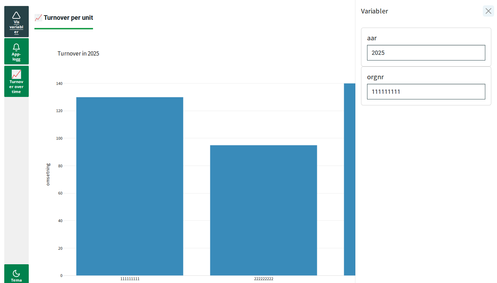

# Getting started: build your first app

In this guide you build a small app, step by step. You start with an empty app and end
with an app that shows two figures that work together.

This guide is the starting point for all other guides. The other guides assume that you
have done this one.

You will learn:

- what an **app skeleton** is, and how to write one in Python
- what the **variable selector** is, and how modules use it
- how to add a **module** as a **tab** or as a **window**
- how to write the same app with an **app config** (a YAML file)
- how to combine YAML and Python, which is the approach we recommend
- how your app connects to your own data

Words in **bold** are explained in the [glossary](../../GLOSSARY.md).

## Before you start

You need:

- A Jupyter service in Dapla Lab.
- A project with its own Python environment. On Dapla we recommend `ssb-project`. See
  [SSB-project in the Dapla manual](https://manual.dapla.ssb.no/statistikkere/ssb-project.html).
- Python 3.12 or newer.

Open a terminal in your project folder and install the package:

```console
poetry add ssb-dash-framework
```

If your project uses uv instead of Poetry:

```console
uv add ssb-dash-framework
```

Then make a new folder for your app, for example `my_app`. You will put the files from
this guide in that folder.

## What you will build

When you are done, your app looks like this:



The app has four areas:

1. **The sidebar** on the left. It has buttons that open the variable selector, the app
   log, your windows and the theme setting (light or dark).
2. **The tabs** at the top. Each tab is a module.
3. **The content** in the middle. This shows the module in the selected tab.
4. **The variable selector panel** on the right. It opens when you click
   *Vis variabler* ("show variables") in the sidebar.

The app also shows short messages (alerts) at the top of the screen when something happens.
You can see all earlier messages if you click *App-logg* in the sidebar.

Every app made with this package has the same areas. These shared parts are called the
**core components**.

## Step 1: The app skeleton in Python

An **app skeleton** is the smallest app that works. It has the core components, but no
modules yet.

Make a file called `app.py` in your app folder, and paste this code into it:

```python
import os

from ssb_dash_framework import VariableSelectorConfig
from ssb_dash_framework import app_setup
from ssb_dash_framework import main_layout

port = 8070

# Find the address prefix that Jupyter uses on Dapla. Outside Dapla it is empty.
service_prefix = (
    os.getenv("DAPLA_ENVIRONMENT") and os.getenv("JUPYTERHUB_SERVICE_PREFIX", "/")
) or ""

# 1. Set up the variable selector.
VariableSelectorConfig(
    ident="orgnr",
    time_units={"name": "aar", "frequency": "year"},
)

# 2. Set up the app.
app = app_setup(port=port, service_prefix=service_prefix, stylesheet="lumen")

# 3. Make the lists for the modules. They are empty for now.
tab_list = []
window_list = []

# 4. Build the layout.
app.layout = main_layout(window_list=window_list, tab_list=tab_list)

# 5. Start the app.
if __name__ == "__main__":
    app.run(
        debug=False,
        port=port,
        jupyter_server_url=os.getenv("JUPYTERHUB_HTTP_REFERER", None),
        jupyter_mode="tab",
        threaded=False,
    )
```

This is what each part does:

1. `VariableSelectorConfig(...)` sets up the variable selector. You do not need to save it
   in a variable. Creating it is enough. Step 2 explains the settings.
2. `app_setup(...)` creates the app. It sets the port, the address prefix and the look of
   the app (`stylesheet`). The address prefix is needed for the app to work through
   Jupyter on Dapla.
3. `tab_list` and `window_list` hold your modules. Modules in `tab_list` become tabs.
   Modules in `window_list` become windows.
4. `main_layout(...)` puts the core components and your modules together into one page.
5. `app.run(...)` starts the app.

### Run the app

In the terminal, go to your app folder and run:

```console
poetry run python app.py
```

With uv, run `uv run python app.py`.

The app is now running. It keeps running until you stop it with `Ctrl+C` in the terminal.

To open the app, look at the address of your Jupyter page in the browser. Replace `lab`
and everything after it with `proxy/8070/`. For example:

```text
https://jupyter.example.ssb.no/lab/tree/my_app       <- Jupyter
https://jupyter.example.ssb.no/proxy/8070/           <- your app
```

You should see an app with the sidebar on the left and no tabs. Click *Vis variabler* to
open the variable selector panel. It has two fields: `aar` and `orgnr`.

> **Note:** You can also run the code in a notebook cell instead of a terminal. Then the app opens
> in a new browser tab by itself, so you do not need to find the address. If you run
> the code a second time in the same notebook, you get the error
> `This option title already exists`. Restart the kernel before you run it again.

## Step 2: The variable selector

Modules must not depend on each other. Still, they need to share some values, for
example which unit and which year you are looking at. The **variable selector** holds
these shared values.

- A module can **read** a value. When the value changes, the module updates itself.
- A module can **write** a value. For example, you click on a unit in a table, and the
  module writes the unit's number to the variable selector.

This is the only way modules talk to each other. Because of this you can add or remove
any module without breaking the others.

Each setting in `VariableSelectorConfig` creates a field in the panel. The value you
give is the name of the field. Modules use this name to find the field.

| Setting | What it is | Example |
| --- | --- | --- |
| `ident` | The main identifier of a unit. | `ident="orgnr"` |
| `refnr` | An identifier for one observation, for example one submitted form. | `refnr="refnr"` |
| `time_units` | The time period. `name` is the field name. `frequency` is one of `year`, `half-year`, `quarter`, `month`, `week` or `day`. | `time_units={"name": "aar", "frequency": "year"}` |
| `secondary_idents` | More identifiers, if you need them. | `secondary_idents=["bedrift"]` |
| `grouping_variables` | Other values that modules can share, for example a form name. | `grouping_variables=["skjema"]` |

All settings are optional. Only add what the modules in your app need. The guide for each
module tells you which settings it needs.

> **Important:** In Python, `VariableSelectorConfig(...)` must come before you create any modules. The
> modules look up their fields when they are created.

## Step 3: Add a module

A **module** is a piece of the app that does one job, such as showing a table or a
figure. In this step you add a `FigureDisplay`. It shows a figure made with Plotly.

Replace the code in `app.py` with this:

```python
import os

import pandas as pd
import plotly.express as px
import plotly.graph_objects as go

from ssb_dash_framework import FigureDisplay
from ssb_dash_framework import VariableSelectorConfig
from ssb_dash_framework import app_setup
from ssb_dash_framework import main_layout

port = 8070

# Find the address prefix that Jupyter uses on Dapla. Outside Dapla it is empty.
service_prefix = (
    os.getenv("DAPLA_ENVIRONMENT") and os.getenv("JUPYTERHUB_SERVICE_PREFIX", "/")
) or ""

# 1. Set up the variable selector.
VariableSelectorConfig(
    ident="orgnr",
    time_units={"name": "aar", "frequency": "year"},
)

# 2. Set up the app.
app = app_setup(port=port, service_prefix=service_prefix, stylesheet="lumen")

# 3. Some example data. In your own app you would read your own data, preferably using get_connection() as explained...
data = pd.DataFrame(
    {
        "aar": ["2024", "2024", "2024", "2025", "2025", "2025"],
        "orgnr": ["111111111", "222222222", "333333333"] * 2,
        "omsetning": [120, 80, 150, 130, 95, 140],
    }
)


# 4. A function that makes the figure.
def turnover_per_unit(aar: str) -> go.Figure:
    """Bar chart with the turnover of every unit in the selected year."""
    selected = data[data["aar"] == aar]
    return px.bar(selected, x="orgnr", y="omsetning", title=f"Turnover in {aar}")


# 5. Make the lists for the modules, and add a module.
tab_list = []
window_list = []

tab_list.append(
    FigureDisplay(
        label="Turnover per unit",
        figure_func=turnover_per_unit,
        inputs=["aar"],
    )
)

# 6. Build the layout.
app.layout = main_layout(
    window_list=window_list,
    tab_list=tab_list,
    default_values={"aar": "2025"},
)

# 7. Start the app.
if __name__ == "__main__":
    app.run(
        debug=False,
        port=port,
        jupyter_server_url=os.getenv("JUPYTERHUB_HTTP_REFERER", None),
        jupyter_mode="tab",
        threaded=False,
    )
```

What is new:

- `turnover_per_unit` is a normal Python function that returns a figure.
- `FigureDisplay(...)` is the module:
  - `label` is the text on the tab.
  - `figure_func` is the function that makes the figure.
  - `inputs=["aar"]` tells the module to **read** `aar` from the variable selector. Every
    time `aar` changes, the module calls `turnover_per_unit` with the new value.
- `default_values={"aar": "2025"}` gives `aar` a value when the app starts.

Stop the app with `Ctrl+C`, and start it again. You should see a tab called
*Turnover per unit* with a bar chart for 2025. Open the variable selector panel and change
`aar` to `2024`. The figure changes.

### Tab or window?

The same module can be a tab or a window. You decide this by choosing which list to put
it in. Change `tab_list.append(` to `window_list.append(` and restart the app.

Now there are no tabs. Instead, there is a new button called *Turnover per unit* in the
sidebar. Click it to open the module in a window. A window is useful for things you
want to look at now and then, on top of the tab you are working in.

Change it back to `tab_list.append(` before you go on.

## Step 4: The app skeleton as an app config

You can also describe an app in a YAML file. This file is called an **app config**.

Make a file called `app.yaml` in your app folder:

```yaml
app_settings:
  port: 8070
  stylesheet: lumen
  logging_level: info
  variableselector:
    ident: orgnr
    time_units:
      name: aar
      frequency: year
```

Then replace the code in `app.py` with this:

```python
from pathlib import Path

from ssb_dash_framework import run_app_from_config

if __name__ == "__main__":
    run_app_from_config(str(Path(__file__).parent / "app.yaml"))
```

Restart the app. You see the same empty app skeleton as in step 1, but with much less code.
`run_app_from_config` reads the file, sets up everything and starts the app. It also
finds the address prefix on Dapla by itself.

The YAML file has two parts:

- `app_settings` has the settings for the app and for the variable selector.
- `modules` lists the modules. It has two lists: `tabs` and `windows`. You do not need it
  yet. You will see examples in [Python or YAML?](#python-or-yaml) below.

> **Note:** In a notebook, `__file__` does not exist. Write the path to the file instead, relative
> to the folder of the notebook, for example `run_app_from_config("app.yaml")`.

## Step 5: Combine YAML and Python

This is the approach we recommend. It is the most flexible:

- The YAML file holds the settings and the standard modules. It is short and easy to read.
- Python is there when you need it, for example for your own functions or your own modules.

Keep `app.yaml` from step 4. Replace the code in `app.py` with this:

```python
import os
from pathlib import Path

import pandas as pd
import plotly.express as px
import plotly.graph_objects as go

from ssb_dash_framework import AppConfig
from ssb_dash_framework import FigureDisplay
from ssb_dash_framework import build_app_from_config
from ssb_dash_framework import config_parser_yaml
from ssb_dash_framework import main_layout

# 1. Read the app config. It sets up the app and the variable selector.
config_path = Path(__file__).parent / "app.yaml"
config = AppConfig(**config_parser_yaml(str(config_path)))
app, tab_list, window_list = build_app_from_config(config)

# 2. Some example data. In your own app you would read your own data, preferably using get_connection() as explained...
data = pd.DataFrame(
    {
        "aar": ["2024", "2024", "2024", "2025", "2025", "2025"],
        "orgnr": ["111111111", "222222222", "333333333"] * 2,
        "omsetning": [120, 80, 150, 130, 95, 140],
    }
)


# 3. Functions that make the figures.
def turnover_per_unit(aar: str) -> go.Figure:
    """Bar chart with the turnover of every unit in the selected year."""
    selected = data[data["aar"] == aar]
    return px.bar(selected, x="orgnr", y="omsetning", title=f"Turnover in {aar}")


def turnover_over_time(orgnr: str) -> go.Figure:
    """Line chart with the turnover of the selected unit for every year."""
    selected = data[data["orgnr"] == orgnr]
    return px.line(selected, x="aar", y="omsetning", title=f"Turnover for {orgnr}")


# 4. Add modules in Python.
tab_list.append(
    FigureDisplay(
        label="Turnover per unit",
        figure_func=turnover_per_unit,
        inputs=["aar"],
        output="orgnr",
        clickdata_func=lambda clickdata: clickdata["points"][0]["x"],
    )
)

window_list.append(
    FigureDisplay(
        label="Turnover over time",
        figure_func=turnover_over_time,
        inputs=["orgnr"],
    )
)

# 5. Build the layout and start the app.
app.layout = main_layout(
    window_list=window_list,
    tab_list=tab_list,
    default_values={"aar": "2025", "orgnr": "111111111"},
)

if __name__ == "__main__":
    app.run(
        debug=False,
        port=config.app_settings.port,
        jupyter_server_url=os.getenv("JUPYTERHUB_HTTP_REFERER", None),
        jupyter_mode="tab",
        threaded=False,
    )
```

What is new:

- `build_app_from_config(config)` does the same as `run_app_from_config`, but it does not
  start the app. It gives you the app and the two module lists, so you can add more
  modules in Python. Any modules listed in the YAML file are already in the lists.
- The tab now also **writes** to the variable selector:
  - `output="orgnr"` tells the module to write to `orgnr` when you click on the figure.
  - `clickdata_func` picks the value to write from the click. Here it is the `orgnr` of
    the bar you clicked.
- The new window **reads** `orgnr`, and shows the turnover of that unit over time.

Restart the app. Click on a bar in the tab, and then open the *Turnover over time* window
from the sidebar. The window shows the unit you clicked on. The two modules work together,
but neither of them knows about the other. They only share the value `orgnr` through the
variable selector.

> **Note:** Some arguments, like Python functions, can't be written in YAML yet. Add these modules
> in Python for now, as in this step.

This is the finished app. You can also find it in the repository, in
[demo/getting_started](https://github.com/statisticsnorway/ssb-dash-framework/tree/main/demo/getting_started).

## Use your own data

In this guide, the data is a small DataFrame in the code. In a real app you read your own
data, for example from tables in ParquEdit on Dapla.

You do this with a shared **connection**. You set it up once, at the top of `app.py`.
After that, your functions and the modules use `get_connection` to read data:

```python
from ssb_dash_framework import get_connection
from ssb_dash_framework import set_parquedit_connection

# Set up the connection once, right after the imports.
set_parquedit_connection()


# Read the data inside the function that needs it.
def turnover_per_unit(aar: str) -> go.Figure:
    """Bar chart with the turnover of every unit in the selected year."""
    with get_connection() as conn:
        t = conn.table("omsetning")
        selected = t.filter(t.aar == aar).to_pandas()
    return px.bar(selected, x="orgnr", y="omsetning", title=f"Turnover in {aar}")
```

There are ready-made functions for the most common places to store data:

- `set_parquedit_connection()` for ParquEdit tables on Dapla. We recommend this one.
- `set_postgres_connection(...)` for a PostgreSQL database.
- `set_sqlite_connection(...)` for a SQLite file.

The guide [Connect to your data](connecting_to_data.md) explains how to use them, and how
to use `get_connection` correctly.

## Python or YAML?

You can configure an app in three ways:

- **Only Python**, as in step 1 to 3.
- **Only YAML**, as in step 4.
- **YAML and Python combined**, as in step 5. We recommend this approach.

| | Good | Not so good |
| --- | --- | --- |
| **YAML** | Short and easy to read. Easy to share and compare between statistics. Easier to update when the package changes. If you misspell an argument, you get an error right away with a list of the valid names. You can split a large file into smaller files with `!include path/to/file.yaml`. | No help from the editor, such as autocomplete or type checks. A few modules read their YAML a little differently from their Python arguments. The guide for each module shows this. |
| **Python** | Full flexibility. Help from the editor, such as autocomplete and type hints. | More code to write and read. Apps look more different from each other. |

### How YAML matches Python

The rule is simple. Every key in a YAML block is passed as an argument with the same name
to the Python class. The examples below show the same thing written both ways.

**App settings and the variable selector.** The keys in `app_settings` are the arguments
to `app_setup()`. The `variableselector` block holds the arguments to
`VariableSelectorConfig()`.

```yaml
app_settings:
  port: 8070
  stylesheet: lumen
  variableselector:
    ident: orgnr
    time_units:
      name: aar
      frequency: year
```

```python
VariableSelectorConfig(
    ident="orgnr",
    time_units={"name": "aar", "frequency": "year"},
)
app = app_setup(port=8070, service_prefix=service_prefix, stylesheet="lumen")
```

**A module.** `type` is the name of the class. The other keys are its arguments. The list
you put the block in decides if the module is a tab or a window.

```yaml
modules:
  tabs:
    - type: ParquetEditor
      statistics_name: Demo
      data_period: "2024"
      data_source: /buckets/produkt/editering-eksempel/inndata/test_p2024_v1.parquet
      id_vars: ["aar", "orgnr"]
```

```python
tab_list.append(
    ParquetEditor(
        statistics_name="Demo",
        data_period="2024",
        data_source="/buckets/produkt/editering-eksempel/inndata/test_p2024_v1.parquet",
        id_vars=["aar", "orgnr"],
    )
)
```

**A module inside a module.** Some arguments take other classes. In YAML, you write these
as new blocks with their own `type`. In Python, you create the objects.

```yaml
buttons:
  - type: DataEditorHistory
  - type: DataEditorSupportTables
```

```python
buttons=[DataEditorHistory(), DataEditorSupportTables()]
```

For every class you can use in YAML, and all its arguments, see the
[YAML configuration reference](../yaml_reference.md).

## Troubleshooting

**The page does not open, or shows "404".**
Check that the address ends with `proxy/8070/`, with the slash at the end. If you use only
Python, check that you have the `service_prefix` line from step 1.

**`Address already in use` when you start the app.**
Another app already runs on port 8070. Stop it with `Ctrl+C` in its terminal, or restart
the notebook kernel that runs it. You can also choose another port, for example `8071`.
Then the address ends with `proxy/8071/`.

**`This option title already exists`.**
`VariableSelectorConfig` was run twice in the same Python session. This often happens in a
notebook. Restart the kernel.

**`No module named '...' found`.**
The `type` in your YAML file does not match a class name. Check the spelling. Upper and
lower case letters matter.

**`... received unexpected kwargs`.**
A key in a YAML block is not an argument of that class. The error message lists the valid
names. Check the spelling.

**Your changes do not show.**
Stop the app with `Ctrl+C` and start it again.

## Next steps

Now you know how an app is built. Next:

- [Connect to your data](connecting_to_data.md)
- [Edit a parquet file with the ParquetEditor](parqueteditor.md)
- [Edit form data with the DataEditor](dataeditor.md)
