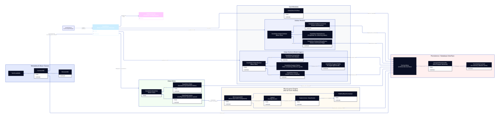

# DataEditor Module Documentation

The `DataEditor` module is a configurable component within the **SSB Dash Framework**. It is designed for micro-level editing, validation, and metadata visualization of statistical survey data (e.g., Altinn questionnaires) within Statistics Norway (SSB) platforms like Dapla.

This document is a reference for the MicroLayout components and explains how the module is built. To learn how to set up a `DataEditor` in your app, with both YAML and Python, follow the guide [Edit form data with the DataEditor](../../guides/dataeditor.md).

---

## Table of Contents

1. [MicroLayout Components Reference](#microlayout-components-reference)
   - [Layout & Grid Containers](#layout--grid-containers)
   - [Leaf & Value Components](#leaf--value-components)
2. [Advanced Architecture & Framework Integration](#advanced-architecture--framework-integration)
   - [Structural Decomposition (InfoRow, Sidebar, Buttons, DataView)](#structural-decomposition)
   - [Decoupled Communication (VariableSelector Integration)](#decoupled-communication)
   - [The Data Access Layer (StandardDataHandler)](#the-data-access-layer)
   - [The MicroLayout Engine (Pydantic, AIO, Callbacks)](#the-microlayout-engine)
3. [Internal Architecture & UML Diagram](#internal-architecture--uml-diagram)

---

## MicroLayout Components Reference

The key to customizing individual data views is `MicroLayout`. It arranges elements on a grid and binds input controls to data fields. In a `MicroLayout` definition, each item has a required `"type"` key.

A `DataViewCustom` layout itself may only contain `row`, `col`, `microlayout` and nested `DataViewCustom` nodes. All components below are used inside the `layout` of a `microlayout` node.

The `microlayout` node accepts these keys in addition to `layout`:

- `inputs`: Variable selector fields that select the form, in the order refnr field, then time unit field. Defaults to the configured `refnr` and time unit.
- Any `EditorSettings` key, for example `field_name_col` or `form_data_table`. These override the `DataEditor` settings for this microlayout only.

`applies_to_forms` and `applies_to_tables` belong on the `DataViewCustom` node, not on the `microlayout` node.

Below is an overview of all supported components:

### Layout & Grid Containers

Container components arrange other elements into columns, rows, or tabular layouts. They contain a list of child configurations in their `children` key.

| Type | Key Properties | Description | Example |
| :--- | :--- | :--- | :--- |
| **`row`** | `children: list` | Arranges all child elements horizontally in a single row. | `{"type": "row", "children": [...]}` |
| **`col`** | `children: list` | Arranges all child elements vertically in a column. | `{"type": "col", "children": [...]}` |
| **`tabs`** | `children: list`<br>`tabs: list` | Displays a tabbed header bar. The tabs shown are the `tab` nodes in `children`. The `tabs` key is required, and can be an empty list. | `{"type": "tabs", "tabs": [], "children": [{"type": "tab", ...}]}` |
| **`tab`** | `label: str`, `children: list` | Represents a single page or view category inside a `tabs` group. | `{"type": "tab", "label": "Step 1", "children": [...]}` |

---

### Leaf & Value Components

Leaf components display static information, gather user input, show chart visualizers, or display auto-calculated numbers.

| Component Type | Properties | Description | Example Configuration |
| :--- | :--- | :--- | :--- |
| **`header`** | `label: str`<br>`size: Literal["xs", "sm", "md", "lg"]` (default `"md"`) | Displays a static title or section header. | `{"type": "header", "label": "Financials", "size": "md"}` |
| **`label`** | `label: str`<br>`bold: bool` | Renders plain static helper text or instructions. | `{"type": "label", "label": "Please verify numbers against receipts."}` |
| **`input`** | `label: str`<br>`variable: str`<br>`id: str`<br>`readonly: bool`<br>`hidelabel: bool`<br>`hidden: bool` | Standard text box for reading and writing data values. Saves when the field loses focus or when the user presses Enter. `id` defaults to `variable`. | `{"type": "input", "label": "Sales", "variable": "/sales_value"}` |
| **`textarea`**| `label: str`<br>`variable: str`<br>`readonly: bool`<br>`hidelabel: bool` | Multiline input box. Best suited for comments, clarifications, or descriptive feedback. Saves when the field loses focus. | `{"type": "textarea", "label": "Notes", "variable": "/notes_path"}` |
| **`dropdown`**| `label: str`<br>`variable: str`<br>`options: list[dict]`| Standard dropdown containing user-defined options of `{label, value}` objects. | `{"type": "dropdown", "label": "Type", "variable": "/sales_type", "options": [{"label": "Domestic", "value": "D"}]}` |
| **`checklist`**|`label: str`<br>`variable: str`<br>`options: list[dict]`| Checklist allowing users to toggle multiple criteria. | `{"type": "checklist", "label": "Tags", "variable": "/tags", "options": [{"label": "E-Commerce", "value": "eco"}]}` |
| **`klass-dropdown`**|`label: str`<br>`variable: str`<br>`klass_code: str`| **SSB-specific!** Connects directly with the **SSB Klass Classification API**. Fetches the classification code list (e.g. `689`) when the app starts and translates them into dropdown options automatically. Requires network access to the KLASS API. | `{"type": "klass-dropdown", "klass_code": "689", "label": "Reason Code", "variable": "/nullOmsAarsak"}` |
| **`klass-checklist`**|`label: str`<br>`variable: str`<br>`klass_code: str`| Similar to `klass-dropdown`, but renders the SSB Klass classifications as a checklist. | `{"type": "klass-checklist", "klass_code": "106", "label": "Industries", "variable": "/industry_codes"}` |
| **`calculated-field`**|`label: str`<br>`ids: dict`<br>`expression: str`<br>`decimals: int`| Runs client-side math calculations in real-time. `ids` maps the names used in `expression` to the ids of other fields (a field's id is its `variable` unless `id` is set). The `expression` is JavaScript. The result is only shown, it is not saved. | `{"type": "calculated-field", "label": "Tax", "ids": {"val": "/sales_value"}, "expression": "Math.round(val * 0.25)"}` |
| **`timeseries`**|`variable: list[str]`<br>`num_periods: int`<br>`label: str`<br>`width: int` | Renders a trend line (sparkline graph) of specific variable values over a past number of periods for historical comparison. | `{"type": "timeseries", "variable": ["/omsVirksomhetPerioden"], "num_periods": 12, "label": "Trend"}` |
| **`dynamic-list`**|`label: str`<br>`variable: str` | Generates a table of all fields matching a pattern, capturing repeating or dynamic field lists. The pattern is a SQL `LIKE` pattern, so use `%` as the wildcard. | `{"type": "dynamic-list", "label": "Sub-entities", "variable": "/sub_units/%"}` |

---

## Advanced Architecture & Framework Integration

To understand how the `DataEditor` fits within the broader SSB Dash Framework, we need to inspect its internal division of responsibilities and flow.

```
+-----------------------------------------------------------------------+
|                       SSB Dash Application                            |
|                                                                       |
|   +---------------------------------------------------------------+   |
|   |                       VariableSelector                        |   |
|   |  - refnr (reference number)                                   |   |
|   |  - ident (organization identification)                        |   |
|   |  - altinnskjema (selected form)                               |   |
|   |  - iso_periode (selected statistical period)                 |   |
|   +-----------------------------------------------+---------------+   |
|                                                   |                   |
|                                                   v triggers callbacks|
|   +---------------------------------------------------------------+   |
|   |                        DataEditor Tab                         |   |
|   |                                                               |   |
|   |  +---------------------------------------------------------+  |   |
|   |  |                        Info Row                         |  |   |
|   |  |  (Displays unit metadata: Orgnr, Name, active Form)     |  |   |
|   |  +---------------------------------------------------------+  |   |
|   |                                                               |   |
|   |  +------------+   +----------------------------------------+  |   |
|   |  |  Sidebar   |   |           Helper Buttons Row           |  |   |
|   |  | - Table    |   |  - Editing History   - Contact Info    |  |   |
|   |  |   Selector |   +----------------------------------------+  |   |
|   |  | - Status   |   +----------------------------------------+  |   |
|   |  |   Tracking |   |               Main View                |  |   |
|   |  | - Comments |   |   (Switches layouts dynamically based  |  |   |
|   |  +------------+   |    on selected Table and Form ID)      |  |   |
|   |                   |                                        |  |   |
|   |                   |    +------------------------------+    |  |   |
|   |                   |    |   DataViewCustom (Form)      |    |  |   |
|   |                   |    |   - Powered by MicroLayoutAIO|    |  |   |
|   |                   |    +------------------------------+    |  |   |
|   |                   +----------------------------------------+  |   |
|   +---------------------------------------+-----------------------+   |
|                                           |                           |
|                                           v reads/writes              |
|   +---------------------------------------+-----------------------+   |
|   |                      StandardDataHandler                      |   |
|   |   (Interacts with underlying Ibis/Postgres/Parquet backend)   |   |
|   +---------------------------------------------------------------+   |
+-----------------------------------------------------------------------+
```

---

### Structural Decomposition

An instantiated `DataEditor` is divided into four major UI panels:

1. **Info Row (`DataEditorInfoRow`)**:
   - Placed at the very top. It displays read-only identity indicators (e.g. enterprise name, organizational code, active form schema) relevant to the current respondent.
   - It queries these variables dynamically from auxiliary metadata tables like `enhetsinfo` depending on the current selections.

2. **Sidebar Modules (`DataEditorHelperSidebar`)**:
   - Placed in the left column.
   - **Table Selector (`DataEditorTableSelector`)**: A dropdown that lets the user choose which table to inspect/edit (e.g., `skjemadata`). Add it to the `sidebar` list. The DataEditor uses its value to pick the data view to show.
   - **Editing Status (`DataEditorSidebarEditingStatus`)**: Allows the statistician to mark a questionnaire as "Ubehandlet" (Unprocessed), "Under arbeid" (Under work/editing), or "Ferdig" (Finished/approved). Writes these flags directly back to the `skjemamottak` tracking table.
   - **Comment Field (`DataEditorSidebarComment`)**: Allows writing and retrieving notes or comments regarding that specific submission.

3. **Helper Buttons (`DataEditorHelperButton`)**:
   - Placed on the top-right card.
   - **History Viewer (`DataEditorHistory`)**: Shows the editing history of the form, as returned by the data handler's `get_history`.
   - **Contact Information (`DataEditorContactInfo`)**: Displays details of the person who submitted the form (e.g., name, phone number, email address) to enable easy verification and communication.
   - **Support Tables (`DataEditorSupportTables`)**: Shows a collection of supporting reference tables in a window.

4. **Main Data View (`DataEditorDataView`)**:
   - Placed on the bottom-right card.
   - Depending on settings, it switches between a full-width spreadsheet editor (**`DataEditorTable`**) powered by AgGrid, or a customized, domain-specific questionnaire view (**`DataViewCustom`**) which parses your `microlayout` definitions.
   - If there are multiple layouts, it registers them under a layout lookup mapping index `(table_name, form_id)` and shows/hides them dynamically based on the current selection.

---

### Decoupled Communication

Modules in the SSB Dash Framework do not call each other directly. Instead, they rely on the **`VariableSelector`** to manage active contextual state (such as the selected company `ident`, statistical period `iso_periode`, or active questionnaire identifier `altinnskjema`).

When a user switches units or periods in the global dropdowns:
1. The `VariableSelector` updates its global reactive attributes.
2. The `DataEditor` catches these changes through built-in Dash callbacks (e.g., `toggle_view_visibility` in `editor.py` listening to `VariableSelector.get_input("altinnskjema")`).
3. These callbacks fetch updated data from the backend, reset editing states, and re-render the appropriate custom micro-layouts for the matching questionnaire structure.

This decoupled architecture makes it extremely simple to plug different views or helper buttons in and out of the app without breaking core editor functionality.

---

### The Data Access Layer

To keep database queries separate from UI layout logic, the `DataEditor` depends on a data handler inheriting from **`FetcherMeta`**. The default implementation is **`StandardDataHandler`**.

The handler performs several tasks:
- **Form Caching**: Employs `FormGetterCached` to cache datasets from the backend on-the-fly, reducing database latency during navigation.
- **Reading Values (`get_field`)**: Queries targeted fields dynamically. For instance, filtering files/tables where the reference number (`refnr`) matches and where the field path (`feltsti`) matches the target variable path.
- **Committing Changes (`update_field_value`)**: Writes individual adjustments back to the database. Whenever a user changes a value in an `input` or `textarea` and leaves the field (or presses Enter), an update signal triggers the handler, which updates the respective table (e.g., updating a cell's string value or setting updated statuses in the tracking database).

The data handler is the only place the `DataEditor` reads or writes data, so any data can be used by writing a handler that inherits from `FetcherMeta` (or from `StandardDataHandler`). See [Use your own data](../../guides/dataeditor.md#use-your-own-data) in the guide.

---

### The MicroLayout Engine

How does a JSON/YAML configuration list get translated into functional Dash components without developer intervention?

1. **Pydantic Validation**:
   When custom views are parsed (via `DataViewCustom.from_yaml` or when loading `AppConfig`), each element in the layout list is parsed against the discriminated union defined in `ssb_dash_framework/modules/data_editor/modules/microlayout/microlayout_components/models.py`.
   If a field is missing required parameters (such as a missing `klass_code` in `klass-dropdown`), the application fails fast during validation, printing precise errors before launching the web server.

2. **All-In-One (AIO) Isolation**:
   To prevent duplicate component ID conflicts when multiple micro-layouts are active simultaneously, the framework encapsulates forms inside the **`MicroLayoutAIO`** layout engine. Each form receives a randomized or structured UUID prefix (`aio_id`). Standard components inside utilize compound dictionary IDs:
   `id={"comp_id": field_variable, "aio": options.aio_id}`

3. **Auto-Wiring Callbacks**:
   Inside `MicroLayoutAIO`, the system loops through all validated leaf components. For every interactive node (like `InputField` or `Textarea`):
   - It instantiates a `FieldCallbackContainer` containing the specific field metadata.
   - It registers a dynamic Dash callback listening to `value` changes. Inputs and textareas are debounced, so they only send their value when the field loses focus or the user presses Enter.
   - When triggered, these callbacks feed changes directly into the `StandardDataHandler` which commits them, completing the end-to-end data flow seamlessly.

---

## Internal Architecture & UML Diagram

To provide a complete map of how the classes, data wrappers, and dynamic layouts coordinate internally, we have authored a detailed **D2 UML Diagram** in [data_editor.d2](https://github.com/statisticsnorway/ssb-dash-framework/blob/main/docs/modules/dataeditor/data_editor.d2).

### Architectural Relationships Map

The D2 diagram outlines several critical layers:
1. **The Core Orchestration Module (`DataEditor`)**: Houses configurations, manages sub-layouts, and connects to the global `VariableSelector` to trigger updates on active context adjustments (such as switching target organizations or periods).
2. **Sub-Modules and Helper Panels**: Holds the layout and callback behavior for contextual widgets like metadata cards (`DataEditorInfoRow`), comments management (`DataEditorSidebarComment`), status toggles (`DataEditorSidebarEditingStatus`), and helper modals (`DataEditorContactInfo`, `DataEditorHistory`, `DataEditorSupportTables`).
3. **The Data Views Grid (`DataEditorTable` & `DataViewCustom`)**: Standard spreadsheet mode coordinates edits directly via SQL wrappers, while custom layouts read tree-like configurations to draw questionnaire interfaces.
4. **The MicroLayout Form Engine (`MicroLayoutAIO`)**: The heart of config-driven layouts. It validates shapes using Pydantic, generates isolated `aio_id` namespaces, auto-wires Javascript-based math callbacks, and dynamically binds value-change listeners.
5. **The Persistence/Database Access Layer (`StandardDataHandler`)**: Implements `FetcherMeta` to wrap all database execution. Integrates `FormGetterCached` to cache datasets on-the-fly and processes `UpdateSkjemadata` models.



### Rendering the UML Diagram

To compile this D2 specification into a visual SVG or PNG diagram, run:
```bash
d2 docs/modules/dataeditor/data_editor.d2 docs/modules/dataeditor/data_editor.svg
```
Or you can paste the contents of `data_editor.d2` into any D2 playground/viewer (e.g., [https://play.d2lang.com/](https://play.d2lang.com/)).
